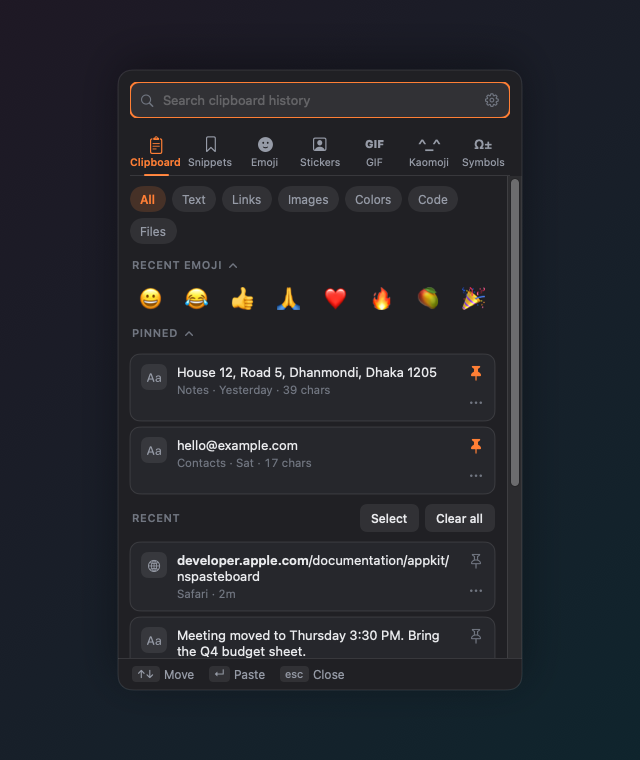
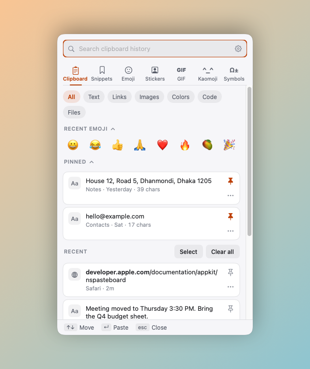
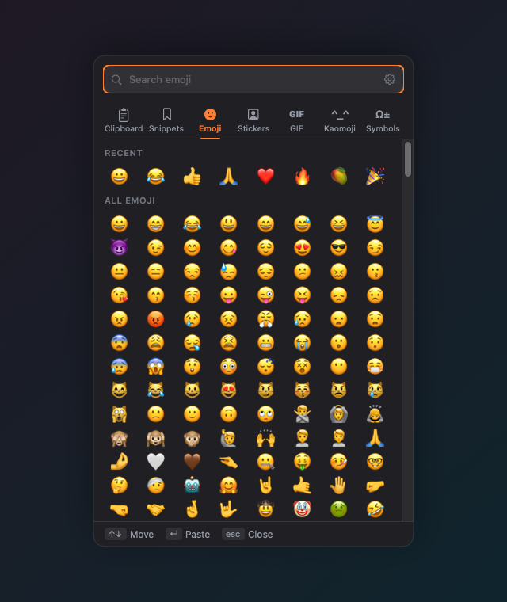
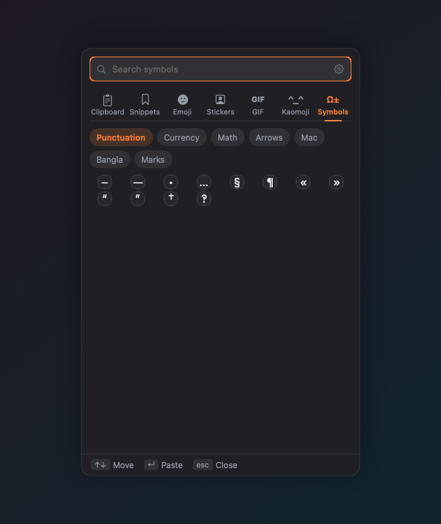
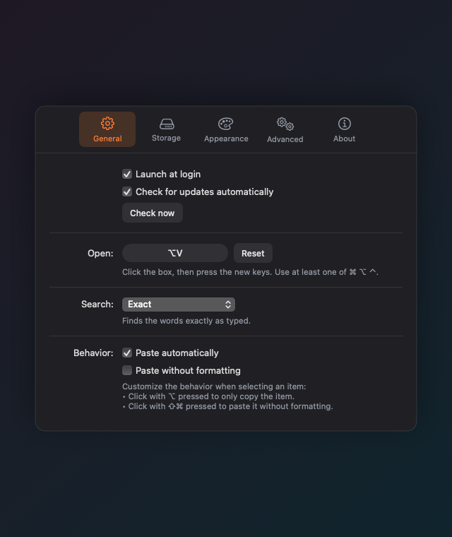

<p align="center">
  
</p>

<h1 align="center">Tuki</h1>

<p align="center">
  <b>The clipboard manager Mac was missing.</b><br>
  Everything from Windows' <kbd>Win</kbd>+<kbd>V</kbd> panel — clipboard history, pins, emoji, GIFs, kaomoji, symbols — plus snippets, stickers and smart paste, in one modern panel.
</p>

<p align="center">
  <a href="https://github.com/shakilnextive-beep/Tuki/releases/latest"></a>
  <a href="https://github.com/shakilnextive-beep/Tuki/releases"></a>
  
  
</p>

---

## ⬇️ Download

| Platform | Download | Status |
|---|---|---|
| 🍎 **macOS** (Apple Silicon & Intel, macOS 15.4+) | [**Download Tuki for Mac**](https://github.com/shakilnextive-beep/Tuki/releases/latest/download/Tuki-mac.zip) | ✅ Available |
| 🪟 **Windows** | — | 🚧 Coming soon |

All versions and release notes: [Releases](https://github.com/shakilnextive-beep/Tuki/releases)

---

## 📸 Screenshots

<p align="center">
  
  
</p>
<p align="center">
  
  
  
</p>
<p align="center">
  
</p>

---

## ✨ Features

- **Clipboard history** — text, links, images, colours, code and files. Search, filter by type, pin what you need, Clear all keeps pins.
- **One-click paste** — click any item and it's pasted where you are typing. Paste several items in the order you pick.
- **Smart actions** — paste as plain text, UPPERCASE / lowercase / Title Case, open a link, paste a colour as RGB or HEX, save as snippet.
- **Snippets in folders** — text you type again and again, one click away.
- **Emoji, Kaomoji & Symbols** — every emoji, searchable; Mac key symbols and Bangla (৳ । ০–৯).
- **GIFs** — search and paste animated GIFs (powered by GIPHY, needs a free key).
- **Stickers** — turn any photo into an iPhone-style sticker with a white border, made on your Mac.
- **Opens beside your text** — the panel appears next to where you type, never on top of it.
- **Your shortcut** — <kbd>⇧</kbd><kbd>⌘</kbd><kbd>V</kbd> by default; change it in Settings.
- **Settings** — what to save, history size, sort order, where the panel opens, menu bar icon, pause recording, clear on quit, and more.
- **Automatic updates** — Tuki checks for new versions and installs them with one click. The old version is replaced; you never end up with two copies.
- **Private** — your history stays on your Mac. Nothing is uploaded.

---

## 🛠 Install on Mac

1. [Download **Tuki-mac.zip**](https://github.com/shakilnextive-beep/Tuki/releases/latest/download/Tuki-mac.zip) and double-click it.
2. Drag **Tuki** into your **Applications** folder.
3. Open Tuki. The first time, macOS may say it *can't verify the developer* (Tuki isn't sold through the App Store). Open **System Settings → Privacy & Security**, scroll down and click **Open Anyway**. You only do this once.
4. Press <kbd>⇧</kbd><kbd>⌘</kbd><kbd>V</kbd>. Tuki shows three short steps to allow pasting (System Settings → Privacy & Security → Accessibility → turn **Tuki** on).

That's it. Tuki lives in the menu bar and starts with your Mac.

### Updating

Tuki checks for updates by itself (Settings → General → *Check for updates automatically*). When a new version is out, click **Install Update** — Tuki downloads it, replaces the old version and restarts. You can also right-click the menu bar icon → **Check for Updates…**

---

## 💬 Reviews & suggestions

Your opinion makes Tuki better:

- ⭐ **Leave a review or suggestion:** [Discussions](https://github.com/shakilnextive-beep/Tuki/discussions)
- 🐞 **Report a problem:** [New issue](https://github.com/shakilnextive-beep/Tuki/issues/new/choose)
- ✉️ **Email:** [shakil.nextive@gmail.com](mailto:shakil.nextive@gmail.com)

If you like Tuki, a ⭐ on this page helps others find it.

---

## 🇧🇩 বাংলায়

**Tuki** হলো Mac-এর জন্য clipboard manager। Windows-এর <kbd>Win</kbd>+<kbd>V</kbd>-এর সব সুবিধা এতে আছে, সাথে আরও কিছু: snippets, sticker, GIF আর বাংলা symbol।

- **ডাউনলোড:** উপরের [Download Tuki for Mac](https://github.com/shakilnextive-beep/Tuki/releases/latest/download/Tuki-mac.zip) লিংকে ক্লিক করুন। Zip খুলে Tuki-কে **Applications** folder-এ টেনে রাখুন।
- **প্রথমবার খুললে** macOS সতর্কবার্তা দেখাতে পারে। তখন **System Settings → Privacy & Security**-এ গিয়ে **Open Anyway** চাপুন।
- **ব্যবহার:** <kbd>⇧</kbd><kbd>⌘</kbd><kbd>V</kbd> চাপুন। Paste করার অনুমতি একবার দিতে হবে, Tuki নিজেই ধাপগুলো দেখিয়ে দেবে।
- **আপডেট:** নতুন version এলে Tuki নিজেই জানাবে। এক ক্লিকে আপডেট হয়ে যাবে, পুরোনোটা মুছে নতুনটা বসে যাবে।
- **মতামত দিন:** [Discussions](https://github.com/shakilnextive-beep/Tuki/discussions) পাতায় লিখুন, অথবা ইমেইল করুন।
- **Windows version:** শীঘ্রই আসছে।

---

## 🧑‍💻 Build from source

Needs macOS 15.4+ and Apple's Command Line Tools (`xcode-select --install`); full Xcode is not required.

```bash
git clone https://github.com/shakilnextive-beep/Tuki.git
cd Tuki
./build.sh install
```

Publishing a new version (maintainer): `./release.sh 1.1.0 "What's new"`.

---

## 👤 Credits

**Creator:** Md. Shakil
**Email:** [shakil.nextive@gmail.com](mailto:shakil.nextive@gmail.com)

GIFs powered by [GIPHY](https://giphy.com).
